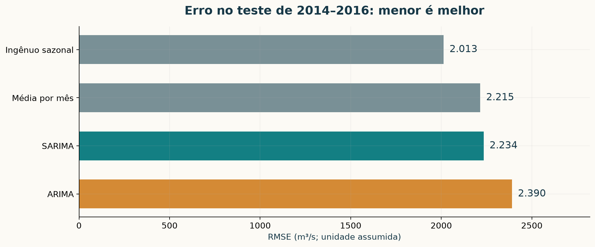

# Ilha Solteira: ARIMA e SARIMA

Projeto de Modelagem Analítica das vazões médias mensais de **Ilha Solteira (34)**, com código explicado, avaliação temporal e intervalos de previsão de 95%. A análise segue os dois exemplos fornecidos, com as correções metodológicas documentadas.

## Comece aqui

- **[Notebook executado e explicado](notebooks/ilha_solteira.ipynb)**: código, tabelas e gráficos em sequência didática.
- **[Guia de estudo e apresentação em PDF](output/pdf/roteiro_ilha_solteira.pdf)**: dados, conceitos, decisões, resultados, código e preparação para perguntas.
- **[Apresentação editável em PowerPoint](output/apresentacao_ilha_solteira.pptx)** e **[slides em PDF](output/pdf/apresentacao_ilha_solteira.pdf)**: 18 slides para 15–20 minutos, com gráficos e notas de fala.
- **[Fala por slide](docs/roteiro_slides.md)** e **[correspondência com os exemplos](docs/como_seguimos_os_exemplos.md)**.
- **[Notebook em Python para o Zed](notebooks/ilha_solteira.py)**, organizado em células `# %%`.



## Resultado principal

O SARIMA escolhido foi melhor que o ARIMA no teste, mas **o ingênuo sazonal teve o menor RMSE entre as quatro alternativas**. Os modelos mantêm autocorrelação residual e seus intervalos de 95% devem ser interpretados como nominais, condicionais às hipóteses do modelo.

| Modelo | Especificação | RMSE | MAE | MAPE | Cobertura nominal de 95% observada |
|---|---|---:|---:|---:|---:|
| ARIMA | (2,0,2), com intercepto | 2.390,47 | 2.122,36 | 76,83% | 91,67% (33/36) |
| SARIMA | (1,0,0)(1,0,1)[12], com intercepto | 2.233,74 | 1.684,14 | 52,31% | 83,33% (30/36) |
| Ingênuo sazonal | Repete 2013 | 2.012,57 | 1.508,67 | 45,47% | Não calculada |
| Média por mês | Média de cada mês até 2013 | 2.214,93 | 1.594,40 | 48,75% | Não calculada |

RMSE e MAE estão na escala da tabela. **m³/s é uma hipótese de unidade**, pois o PDF não declara unidade, agência ou se as vazões são naturais/observadas/afluentes/defluentes. As conclusões não atribuem causas hidrológicas que os dados não permitem identificar.

## Dados e protocolo

A fonte contém **1.032 meses de janeiro de 1931 a dezembro de 2016**, sem lacunas, duplicatas ou valores não positivos. A extração preserva todos os valores, registra página e linha e foi conferida por outra extração baseada nas células do PDF. Não houve imputação nem remoção de extremos.

1. **1931–2008:** treino inicial, exploração, ADF/KPSS e busca de 46 especificações.
2. **2009–2013:** validação com cinco origens anuais e horizontes de 12 meses; treino crescente. Dois menores AIC por grupo `(família,d,D)` vão à validação; o RMSE médio escolhe uma ordem por família.
3. **2014–2016:** teste de 36 meses a partir de uma única origem em dezembro de 2013. As ordens já estão fixadas. Não há atualização com os dados do teste.
4. **2017:** reajuste até dezembro de 2016 e projeção histórica de 12 meses. O arquivo não contém observações de 2017. **Não é uma previsão atualizada para 2026.**

Os modelos usam o log da vazão centrado pela média do log do respectivo treino. A centragem melhora a estabilidade da estimação e é desfeita na previsão. A média na escala original é `exp(mu + variancia/2)`; a mediana é `exp(mu)`. Os limites vêm de `get_forecast(...).conf_int(alpha=0.05)` na escala log e são exponenciados depois de devolver o centro. São **intervalos de previsão**, distintos dos intervalos de confiança dos coeficientes.

A busca é reduzida: ARIMA `p,q ∈ {0,1,2}, d ∈ {0,1}`; SARIMA `p,q,P,D,Q ∈ {0,1}, d=0, s=12`, excluindo a combinação sem parte sazonal. Não é uma busca exaustiva. A validação de 12 meses e o teste de 36 meses medem horizontes diferentes; isso é uma limitação explicitada nos materiais.

## Executar

Ambiente verificado: **Python 3.12**, statsmodels 0.14.6. As versões exatas estão em [requirements-lock.txt](requirements-lock.txt).

```bash
python3 -m venv .venv
source .venv/bin/activate
python -m pip install -r requirements-lock.txt
python -m ipykernel install --user --name ilha-solteira --display-name "Python (Ilha Solteira)"
python scripts/analisar.py
python -m src.graficos
python scripts/criar_roteiro.py
```

O notebook entregue já está executado. Para abrir no JupyterLab:

```bash
python -m jupyterlab notebooks/ilha_solteira.ipynb
```

Para executar novamente sem interface:

```bash
jupyter nbconvert --to notebook --execute --inplace \
  --ExecutePreprocessor.timeout=300 \
  --ExecutePreprocessor.kernel_name=ilha-solteira \
  notebooks/ilha_solteira.ipynb
python scripts/verificar.py
```

No notebook, `REFAZER_BUSCA=False` usa as ordens salvas e **reajusta os modelos e recalcula as previsões**, conferindo os resultados contra os CSVs. Mude para `True` para repetir a seleção. Se modificar a metodologia, regenere também todas as tabelas e materiais para manter a consistência.

## Usar no Zed

Abra a pasta do projeto e `notebooks/ilha_solteira.py`. Selecione o kernel **Python (Ilha Solteira)** e use **Ctrl+Shift+Enter** para executar cada célula `# %%`. A configuração local `.zed/settings.json` seleciona o kernel `ilha-solteira`. Se necessário, execute `repl: refresh kernelspecs` e selecione `.venv` em `toolchain: select`.

O `.ipynb` é a versão com resultados embutidos para Jupyter/GitHub; a versão `.py` aproveita o suporte do Zed a notebooks como scripts. [Documentação oficial do REPL](https://zed.dev/docs/repl).

## Regenerar os slides

O código autoral está em [scripts/criar_slides.mjs](scripts/criar_slides.mjs), usando `@oai/artifact-tool` e o runtime de apresentações do Codex. Os slides finais podem ser abertos normalmente sem esse runtime; regenerar o PPTX a partir do código requer o runtime e a skill usados na criação.

```bash
export RUNTIME_NODE_MODULES="$HOME/.cache/codex-runtimes/codex-primary-runtime/dependencies/node/node_modules"
export RUNTIME_PYTHON="$HOME/.cache/codex-runtimes/codex-primary-runtime/dependencies/python/bin/python3"
export SKILL_DIR="$HOME/.codex/plugins/cache/openai-primary-runtime/presentations/26.921.10847/skills/presentations"
SLIDES_OUTPUT=output/apresentacao_regenerada.pptx \
  "$HOME/.cache/codex-runtimes/codex-primary-runtime/dependencies/node/bin/node" scripts/criar_slides.mjs
```

O script cria uma revisão temporária inédita, valida e copia para `SLIDES_OUTPUT` (ou para o destino padrão), substituindo esse resultado. O PDF é regenerado em `output/pdf/apresentacao_ilha_solteira.pdf`. A apresentação contém gráficos nativos com dados editáveis e notas de fala; seu PDF é uma renderização em alta resolução.

## Organização

| Caminho | Conteúdo |
|---|---|
| `data/raw/` | PDF original de Ilha Solteira |
| `data/processed/` | CSV mensal auditável e metadados |
| `referencias/` | Dois PDFs de exemplo fornecidos |
| `src/dados.py` | Extração e validação dos dados |
| `src/modelos.py` | Testes, busca, ajustes, métricas, previsões e resíduos |
| `src/graficos.py` | Figuras da análise em PNG e SVG |
| `notebooks/` | Código didático em `.py` e `.ipynb` executado |
| `scripts/` | Execução, materiais e verificação |
| `output/tables/` | Candidatos, validação, previsões, métricas, resíduos e resumos |
| `output/figures/` | 12 gráficos em PNG e SVG |
| `output/pdf/` | Roteiro de estudo e slides em PDF |
| `docs/` | Mapeamento dos exemplos e fala por slide |

## Referências

Os exemplos fornecidos orientam a sequência de preparação, exploração, transformações, ACF/PACF, ARIMA, SARIMA e previsão. Foram corrigidos o período sazonal, as chamadas antigas, o uso incorreto de intervalos dos coeficientes, a avaliação em períodos diferentes e a seleção na série completa. `EXEMPLO_01.pdf` contém apenas cinco páginas físicas do documento indicado nos rodapés.

- [DigitalOcean: tutorial indicado](https://www.digitalocean.com/community/tutorials/a-guide-to-time-series-forecasting-with-arima-in-python-3).
- [GeeksforGeeks: tutorial indicado](https://www.geeksforgeeks.org/python-arima-model-for-time-series-forecasting/amp/).
- [Notebook AirPassenger indicado](https://github.com/aarshayj/analytics_vidhya/blob/master/Articles/Time_Series_Analysis/Time_Series_AirPassenger.ipynb).
- [statsmodels: SARIMAX](https://www.statsmodels.org/stable/generated/statsmodels.tsa.statespace.sarimax.SARIMAX.html).
- [statsmodels: get_forecast](https://www.statsmodels.org/stable/generated/statsmodels.tsa.statespace.mlemodel.MLEResults.get_forecast.html).

DigitalOcean e GeeksforGeeks não retornaram o texto integral na consulta realizada. A implementação foi fundamentada nos PDFs anexados e na documentação oficial das APIs. Os materiais fornecidos foram preservados com sua identificação original.
